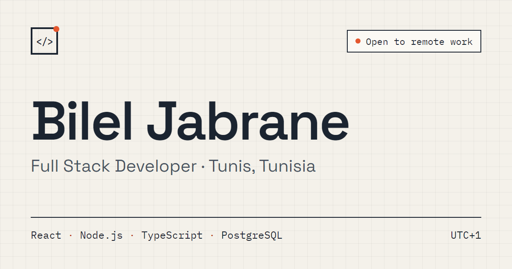

# Bilel Jabrane · Portfolio

Personal site of Bilel Jabrane, a full stack developer based in Tunis, Tunisia (UTC+1), open to remote work.



## Projects featured

- **[OnePlace](https://oneplace-c1b.pages.dev/communities)**: a multi-tenant SaaS where creators run paid private communities with memberships, courses, events and analytics.
- **[Loupe](https://loupe-ashen.vercel.app/en)**: a free website health check that explains SEO, speed and accessibility problems in plain language, in English, French and Arabic. ([code](https://github.com/Bileljb/Loupe))

## Built with

React 19 · TypeScript (strict) · Vite · Tailwind CSS 4 · React Router · Vitest

## Highlights

- **Content as typed data.** Every project page renders from one typed file (`src/data/projects.ts`). Adding a project means adding one object, and missing sections hide themselves.
- **Lighthouse 100** for accessibility, best practices and SEO on mobile and desktop, and 95+ for performance on mobile.
- **Accessible by default.** Keyboard navigation, visible focus states, AA contrast in both themes, and motion that respects `prefers-reduced-motion`.
- **Light and dark themes** from a single set of design tokens.
- **Fast demo videos.** YouTube embeds show a thumbnail first and only load the player (via `youtube-nocookie.com`) on click.
- **SEO.** Per-page titles, descriptions and Open Graph tags, plus a sitemap generated at build time.

## Run locally

Requires Node.js 20+.

```bash
npm install
npm run dev       # http://localhost:5173
```

Other scripts: `npm run build`, `npm run preview`, `npm run lint`, `npm test`.

Before building, create a `.env` file with `VITE_SITE_URL=<your site URL>` (used for the sitemap and Open Graph tags).

## Structure

```
src/
  data/         profile, projects and their types
  components/   layout, home, project and UI components
  pages/        home, project page, 404
  lib/          project queries, YouTube URL parsing, theme
  hooks/        per-page meta tags
public/         icons, Open Graph image, project screenshots
scripts/        sitemap and robots.txt generation
```

## Contact

[bileljabrane6@gmail.com](mailto:bileljabrane6@gmail.com) · [LinkedIn](https://www.linkedin.com/in/bilel-jabrane-a9989b218/) · [GitHub](https://github.com/Bileljb)
